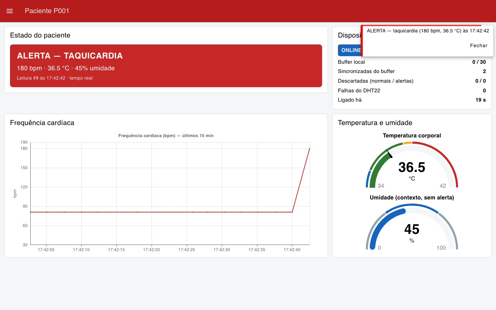
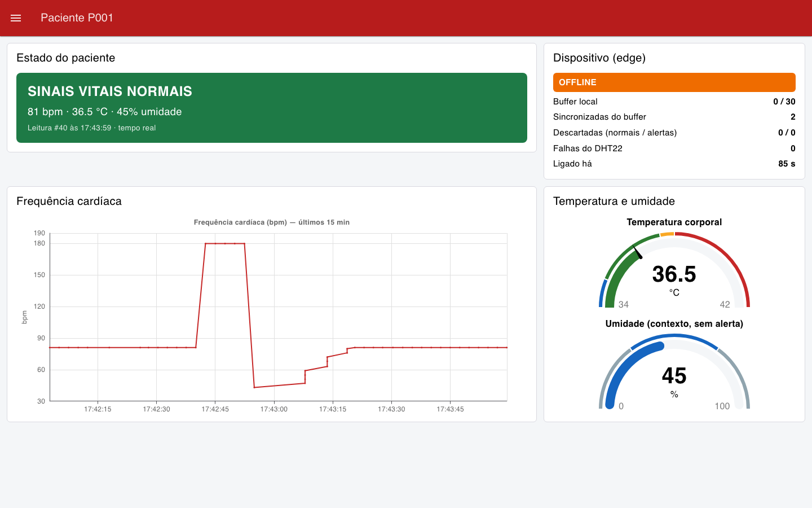
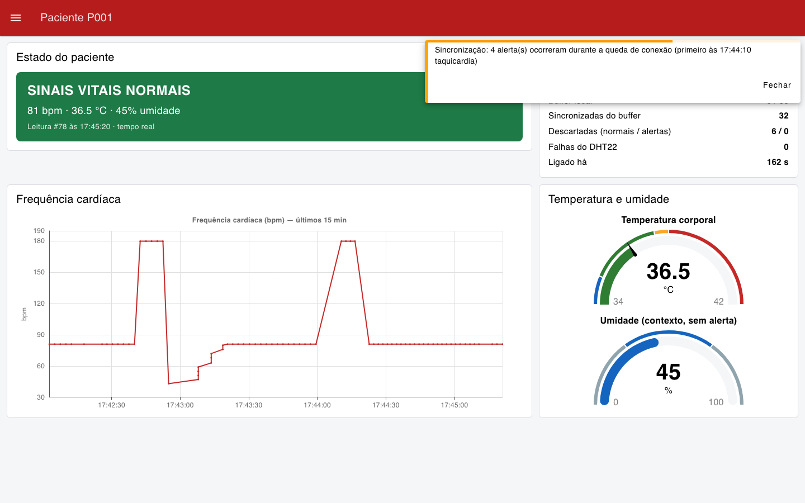

# CardioIA — Fase 3: Monitoramento Contínuo (IoT)

Protótipo de um vestível cardíaco do projeto **CardioIA** (FIAP). Um ESP32 simulado no Wokwi
lê temperatura e frequência cardíaca, guarda os dados quando a conexão cai, envia tudo por
MQTT e alimenta um dashboard no Node-RED com alertas automáticos.

| Parte | Pergunta | Abordagem |
|---|---|---|
| **1 — Edge** | *O que acontece com os dados quando a internet cai?* | Buffer local com limite justificado; descarta leituras normais antes de alertas; sincroniza em ordem quando a conexão volta |
| **2 — Fog/Cloud** | *Como a equipe de saúde vê e é avisada?* | ESP32 → MQTT (HiveMQ) → Node-RED → Dashboard 2.0 com gráfico, gauge e notificação de alerta |

🔌 **Projeto no Wokwi:** https://wokwi.com/projects/479248832316384257
📄 **Relatórios:** [Parte 1 — Edge](docs/relatorio_parte1_edge.pdf) · [Parte 2 — Fog/Cloud](docs/relatorio_parte2_fog_cloud.pdf)



---

## Resultados medidos

**Resiliência offline no Wokwi** (rodada de 29/10/2026, buffer de demonstração com 30 posições,
log em [`docs/evidencias/wokwi_serial.log`](docs/evidencias/wokwi_serial.log)):

| Situação | Resultado |
|---|---|
| Alertas de taquicardia durante a queda | 4, todos preservados |
| Leituras normais descartadas com o buffer cheio | 6 |
| Alertas descartados | **0** |
| Reconexão ao broker | 1ª tentativa |
| Leituras sincronizadas na volta | **30**, em ordem |

**Resiliência offline, teste automatizado** do próprio firmware ([`esp32/teste_host`](esp32/teste_host)), com buffer de 8 posições.

| Situação simulada | Resultado |
|---|---|
| Leituras feitas offline | 14: 3 normais, 4 alertas (3 taquicardias, 1 febre), 7 normais que estouram o buffer |
| Alertas guardados → alertas que chegaram à nuvem | **4 → 4** |
| Leituras normais descartadas | 6 |
| Alertas descartados | **0** |
| Ordem cronológica na sincronização | preservada |
| Mesmo teste com a política sabotada ("descarta a mais antiga") | **falha**: só 1 de 4 alertas sobrevive |

**Firmware** (`arduino-cli`, placa DOIT ESP32 DevKit v1): compila sem erros. Usa 69% da
flash e 14% da RAM com MQTT; o buffer de produção (1800 leituras = 1 h offline) ocupa
28,8 KB.

**Dashboard:** recebe pelo broker público, reconstrói o horário das leituras que vieram do
buffer e resume em uma notificação os alertas que aconteceram durante a queda.

| Queda de conexão | Depois da sincronização |
|---|---|
|  |  |

> Prints da mesma rodada: o ESP32 do Wokwi publicando no HiveMQ e o Node-RED local recebendo.
> No gráfico da direita, o 2º pico é a taquicardia que aconteceu **durante a queda**, enviada
> do buffer e colocada no horário em que foi medida.

## Como rodar

**1. ESP32 no Wokwi:** abra o link do projeto e clique em ▶. No Monitor Serial:

- `[MQTT] conectado` → o dispositivo está publicando;
- botão azul **Wi-Fi** → alterna online/offline (veja `[OFFLINE]`, `[BUFFER] cheio`, `[SYNC] concluida`);
- potenciômetro → BPM de 40 a 180 (acima de 120 dispara `[ALERTA] taquicardia`);
- clique no DHT22 → ajuste a temperatura (acima de 38 °C dispara `[ALERTA] febre`).

Para montar o projeto do zero: crie um ESP32 no wokwi.com e cole `esp32/cardioia_monitor/cardioia_monitor.ino` (como `sketch.ino`), `esp32/diagram.json` e `esp32/libraries.txt`.

**2. Node-RED + dashboard** (Node.js 22.9 ou mais novo, exigência do Node-RED 5):

```bash
cd node-red
npm install
npm start
# editor:    http://localhost:1880
# dashboard: http://localhost:1880/dashboard
```

O flow (`node-red/flows.json`) é carregado automaticamente. Para usar em outro Node-RED:
menu → Import → selecione o arquivo e instale `@flowfuse/node-red-dashboard` pela paleta.

**3. Sem Wokwi (opcional):** simulador do ESP32 e teste do firmware no computador.

```bash
python -m venv .venv && .venv/bin/pip install -r requirements.txt
.venv/bin/python tools/simulador_esp32.py --cenario queda   # normal | alerta | queda
esp32/teste_host/rodar.sh                                   # precisa de arduino-cli + ArduinoJson
```

## Estrutura

```
esp32/
  cardioia_monitor/cardioia_monitor.ino   firmware C++ comentado
  diagram.json, libraries.txt             circuito e bibliotecas do Wokwi
  teste_host/                             teste da resiliência rodando o .ino no computador
node-red/
  flows.json                              flow exportado (MQTT → dashboard + alertas)
  package.json, settings.js               Node-RED 5 + Dashboard 2.0
tools/
  simulador_esp32.py                      publica o mesmo payload do ESP32 (teste)
  screenshots.py                          prints do dashboard/editor (Playwright)
docs/
  relatorio_parte1_edge.md / .pdf
  relatorio_parte2_fog_cloud.md / .pdf
  img/, evidencias/
```

## Decisões técnicas

- **Um firmware para as duas partes.** Todo envio aparece no Monitor Serial (`[NUVEM]`,
  pedido da Parte 1) e é publicado via MQTT (Parte 2). A flag `USAR_MQTT 0` deixa só o
  Serial, para testar a resiliência sem rede.
- **Buffer em RAM, não SPIFFS.** O SPIFFS é volátil no simulador e não pontua. O buffer fica
  atrás de 4 funções; trocar por NVS/LittleFS num chip real não mexe na política.
- **Limite de 1 hora** (1800 leituras a cada 2 s, o máximo do DHT22). Cobre a queda de
  internet residencial. No Wokwi usamos 30 leituras para a política aparecer em 1 minuto.
- **Alertas nunca saem antes das leituras normais.** Perder uma leitura normal custa pouco;
  perder o registro de uma taquicardia, não.
- **Horário reconstruído no Node-RED.** O ESP32 não tem relógio. Cada leitura leva
  `idade_ms`, e as leituras sincronizadas aparecem no gráfico no momento em que foram medidas.
- **Potenciômetro como BPM** (no lugar do botão sugerido). Permite mostrar taquicardia e
  bradicardia na hora. Fica no GPIO 34 (ADC1), porque o ADC2 não funciona com o Wi-Fi ligado.
- **Broker público sem credencial.** O projeto Wokwi é público, então qualquer senha no
  código ficaria exposta. O relatório da Parte 2 detalha o que muda em produção (TLS, ACL,
  credencial por dispositivo, LGPD).
- **Dashboard 2.0** (`@flowfuse/node-red-dashboard`): o `node-red-dashboard` antigo está
  oficialmente sem manutenção.

## Limites de uso

- Protótipo acadêmico. Não é um dispositivo médico.
- O BPM vem de um potenciômetro e a "temperatura corporal" é a temperatura ambiente do DHT22.
- `broker.hivemq.com` é público: qualquer pessoa pode assinar os tópicos. Não use dados reais.
- O buffer em RAM se perde se o dispositivo desligar enquanto estiver offline.

## Equipe

| Nome | RM |
|---|---|
| Guilherme Paes Barreto Didier Garcia | RM568457 |
| Davis Roberto | RM567941 |
| Guilherme Chan | RM567722 |
| Deivid Paula da Silva Oliveira | RM566752 |

FIAP — Inteligência Artificial · Projeto CardioIA · Fase 3
