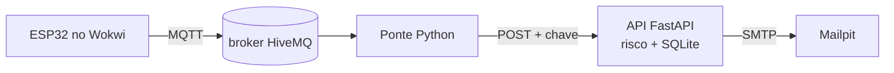
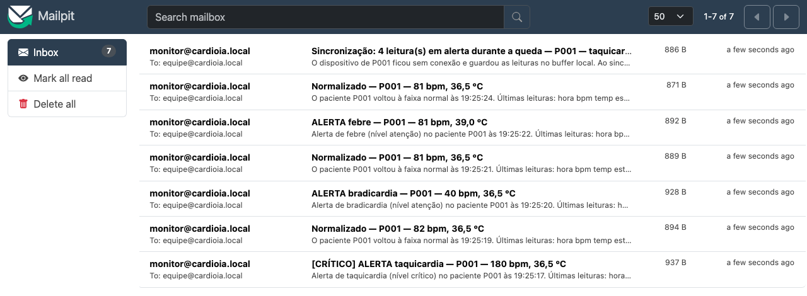
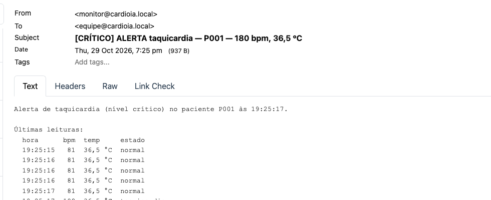

# CardioIA — Fase 3 · Ir Além 1

## Comunicação automatizada com REST e e-mail

**FIAP — Inteligência Artificial · Projeto CardioIA**

Equipe: Guilherme Paes Barreto Didier Garcia (RM568457) · Davis Roberto (RM567941) · Guilherme Chan (RM567722) · Deivid Paula da Silva Oliveira (RM566752)

---

### 1. Fluxo

A API é um segundo consumidor dos tópicos do dashboard: o ESP32 não mudou uma linha. A ponte
(`api/cliente/ponte_mqtt.py`) assina `leituras` e `status` (não `alertas`, que repete leituras)
e repassa cada mensagem à API pelo cliente REST (`api/cliente/cliente_rest.py`), que também
faz as consultas da equipe.

### 2. API REST

| Rota | Papel | O que faz |
|---|---|---|
| `POST /pacientes/{id}/leituras` · `/status` | dispositivo | Recebe o JSON do firmware, reavalia o risco, grava e avisa |
| `GET /pacientes/{id}/leituras` · `/alertas` · `/resumo` | equipe | Histórico e resumo (estado, alertas em 24 h, dispositivo) |
| `GET /emails` · `GET /saude` | equipe · público | Log dos e-mails (enviado/falhou) · funcionamento |

**Autenticação.** Header `X-API-Key`, com uma chave por papel: o dispositivo só escreve e a
equipe só lê. Sem chave ou chave inválida → **401**; papel errado → **403**. As chaves ficam em
`api/.env` (fora do git) e a API não sobe sem elas; os GETs também exigem chave (dado de saúde).

**Validação.** O corpo segue o formato do firmware. Campo desconhecido, `bpm` fora de 0–300,
`idade_ms` negativa ou paciente divergente da rota → **422**. O horário da medida é
`recebida − idade_ms`, então o que veio do buffer entra no histórico no lugar certo.

### 3. Lógica de risco

Os limiares são os mesmos do firmware e do Node-RED, nos três pontos da cadeia: taquicardia
**> 120 bpm**, bradicardia **< 50 bpm**, febre **> 38,0 °C**, hipotermia **< 35,0 °C**. Sem
temperatura (falha do DHT22), a leitura é marcada como erro do sensor, não como febre. Se a
classificação da API discordar do campo `alerta` do ESP32, a resposta sinaliza
`divergencia_esp32`.

A API acrescenta um **nível**: *atenção* com um motivo; *crítico* com dois motivos ou valor
extremo (BPM > 150 ou < 40, temperatura > 39,5 °C ou < 34,0 °C), marcado `[CRÍTICO]` no e-mail.

### 4. Automação de e-mail

| Situação | E-mail |
|---|---|
| Leitura em tempo real passa de normal a alerta | Um "ALERTA" com a leitura e as 5 anteriores (não repete enquanto o alerta continua) |
| Volta ao normal | Um "Normalizado" |
| Alertas que chegam do buffer depois de uma queda | **Um** resumo no fim da sincronização, com a contagem por tipo |
| Nenhuma leitura por mais de 60 s (o "sem movimento" deste protótipo) | "Sem dados do paciente", uma vez por episódio |

São as regras do Node-RED, aplicadas por um "robô" (RPA) que faz o que um plantonista faria à
mão. O envio é SMTP real (`smtplib`) para o **Mailpit**, servidor de teste em Docker que não
repassa nada à internet. Se o SMTP cair, a leitura é gravada e a falha fica no log de e-mails.

### 5. Evidências

**Testes:** 35 testes `pytest` passando (`api_pytest.log`): autorização (401/403 em escrita e
consulta), fronteiras dos limiares, validação, e-mails (SMTP local que captura as mensagens) e
ponte. Sabotando a autenticação, 5 falham; sabotando a regra de não repetir e-mail, 4.

**Log real do ESP32.** A ponte releu pela API o tráfego MQTT da rodada no Wokwi
(`broker_mqtt.log`; o tempo fica comprimido, mas as leituras são as do ESP32): **142 leituras** e
25 status gravados, e **7 e-mails** na ordem do dashboard (taquicardia crítica, normalizado,
bradicardia, normalizado, febre, normalizado, resumo da queda "taquicardia ×4"). O `GET /resumo`
conta **8 taquicardias, 3 bradicardias e 3 febres**, como o Monitor Serial.

**Ao vivo pelo broker** (`api_ponte_mqtt.log`, com o simulador no cenário de queda): 30
leituras, um único resumo "taquicardia ×4, febre ×4" e, 60 s depois da última leitura, o e-mail
"Sem dados do paciente P001 há 60 s".

<table class="fotos"><tr><td></td><td></td></tr></table>

### 6. Limites e o que mudaria em produção

Chave estática, SQLite local e estado das notificações em memória (zera ao reiniciar; sem
deduplicação por `seq`) bastam para o protótipo. Em produção: OAuth2/JWT por dispositivo, HTTPS,
banco gerenciado com retenção (LGPD) e envio por fila com nova tentativa. Como rodar: ver o README.
