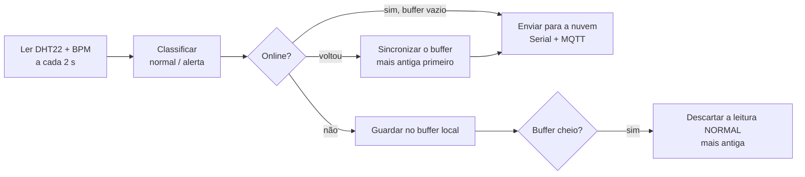
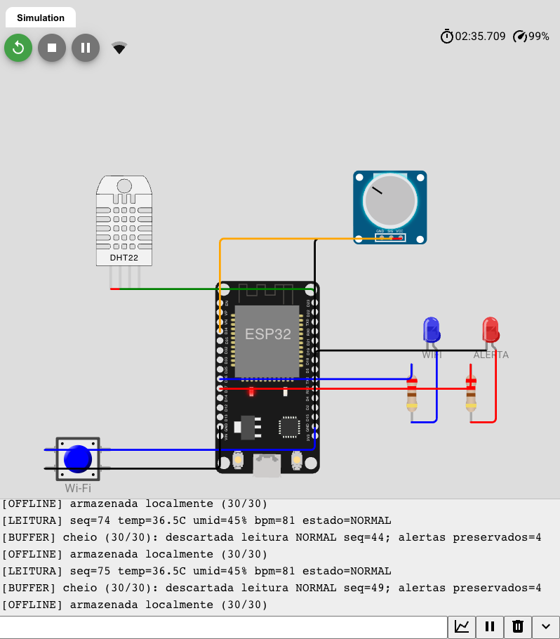

# CardioIA — Fase 3 · Relatório da Parte 1

## Armazenamento e processamento local (Edge Computing)

**FIAP — Inteligência Artificial · Projeto CardioIA**

Equipe: Guilherme Paes Barreto Didier Garcia (RM568457) · Davis Roberto (RM567941) · Guilherme Chan (RM567722) · Deivid Paula da Silva Oliveira (RM566752)

---

### 1. Cenário

Um paciente cardíaco em monitoramento domiciliar usa um dispositivo vestível que mede
temperatura corporal e frequência cardíaca. A conexão de casa cai algumas vezes por dia,
às vezes por vários minutos. Nesse intervalo, o dispositivo não pode perder o que mediu,
principalmente as leituras que indicam risco. Quando a conexão volta, a equipe de saúde
precisa receber o histórico completo, na ordem certa.

O protótipo simula esse vestível em um ESP32 no Wokwi.

### 2. Hardware

| Componente | Pino | Papel |
|---|---|---|
| DHT22 | GPIO 15 | Sensor obrigatório: temperatura (usada como temperatura corporal) e umidade |
| Potenciômetro | GPIO 34 | 2º sensor: frequência cardíaca simulada, mapeada para 40–180 bpm |
| Botão "Wi-Fi" | GPIO 4 | Liga e desliga a conectividade simulada (variável booleana `wifiSimuladoLigado`); debounce de 50 ms em software |
| LED azul | GPIO 26 | Aceso = online · piscando = Wi-Fi ligado, mas sem broker · apagado = offline |
| LED vermelho | GPIO 27 | Aceso enquanto a última leitura for um alerta |

**Por que um potenciômetro para o BPM:** o enunciado sugere um botão apertado *x* vezes por
minuto. Um potenciômetro permite levar o valor a 130 bpm, ou a 45, e mostrar o alerta na
hora, sem depender do ritmo de quem aperta. **Por que o GPIO 34:** ele pertence ao ADC1. O
ADC2 do ESP32 fica indisponível quando o Wi-Fi está ligado. **O botão** fica com o *bounce*
mecânico simulado pelo Wokwi ligado, e o firmware filtra com debounce de 50 ms: na rodada de
testes documentada, feita com este circuito, os dois cliques no botão geraram exatamente um
`[WIFI] simulado: DESLIGADO` e um `LIGADO`.

### 3. Fluxo de funcionamento



1. **Leitura (a cada 2 s).** O DHT22 aceita no máximo uma leitura a cada 2 segundos (0,5 Hz);
   esse limite físico define o intervalo. O BPM é a média de 4 leituras do ADC, para
   suavizar o ruído.
2. **Classificação no próprio dispositivo.** Cada leitura recebe flags de alerta:
   - taquicardia: FC > 120 bpm. Acima de 100 já é taquicardia em repouso; 120 reduz o
     falso alarme em esforço leve.
   - bradicardia: FC < 50 bpm. Abaixo de 60 já é bradicardia; 50 evita alarmar atletas e
     o sono.
   - febre: T > 38,0 °C.
   - hipotermia: T < 35,0 °C.

   A umidade é registrada como contexto ambiental e não gera alerta. A classificação
   precisa acontecer na borda, porque é ela que decide o que preservar quando falta espaço.
3. **Envio.** Online e sem pendências, a leitura vai direto para a "nuvem". Todo envio é
   impresso no Monitor Serial com a tag `[NUVEM]`, como pede o enunciado
   (`Serial.println`). Na Parte 2, o mesmo envio também é publicado via MQTT.
4. **Offline.** A leitura vai para o buffer local: `[OFFLINE] armazenada localmente (5/30)`.
5. **Volta da conexão.** O buffer é enviado do mais antigo para o mais novo, em lotes de 10
   por volta do `loop()`, para não travar a leitura dos sensores. **Cada registro só é
   apagado do buffer depois que o `publish()` é aceito pela conexão.** Se o envio falha, o
   registro fica para a próxima tentativa. Com QoS 0 não há confirmação do broker; a seção 2
   do relatório da Parte 2 discute esse limite. A sincronização roda **antes** da leitura
   do ciclo: ao reconectar com o buffer cheio, ela abre espaço primeiro, e a leitura nova
   não precisa descartar ninguém.

Enquanto houver pendências, a leitura nova entra no fim da fila em vez de passar na frente.
Assim, a nuvem recebe tudo em ordem cronológica.

### 4. Lógica de resiliência

**Estrutura.** É um buffer circular estático de registros de 16 bytes (sequência, instante
da leitura, temperatura × 10, umidade, BPM e flags). O buffer é um vetor de tamanho fixo,
reservado na compilação: ele não usa o heap e não fragmenta a memória num dispositivo que
deveria rodar por semanas. A montagem de cada mensagem (o JSON, via ArduinoJson, e o texto do
motivo do alerta) usa o heap de forma temporária e libera tudo ao fim do envio.

#### Limite de armazenamento e por quê

| Configuração | Capacidade | Autonomia offline | Memória |
|---|---|---|---|
| Produção (`MODO_DEMO 0`) | 1800 leituras | **1 hora** a 1 leitura / 2 s | 28,8 KB dos ~320 KB de RAM |
| Demonstração no Wokwi (`MODO_DEMO 1`) | 30 leituras | 1 minuto | 480 bytes |

Uma hora cobre o caso que o produto precisa resolver: a queda de internet residencial e o
paciente que sai de casa para um exame. Uma ausência mais longa deixa de ser "queda" e vira
"dispositivo sem conectividade". Esse caso pede outro desenho (memória não volátil, aviso ao
paciente) e não um buffer maior. No Wokwi usamos 30 posições para que o avaliador veja a
política de descarte funcionando em um minuto. O valor é uma única constante no código.

#### Política de descarte (buffer cheio)

1. Sai a **leitura normal mais antiga**.
2. **Alertas são preservados.** Um alerta só é descartado se o buffer inteiro for de alertas.
   Nesse caso sai o alerta mais antigo e o fato é registrado em `[BUFFER] AVISO` e no
   contador `descartadas_alertas`.

A política parte de uma premissa: num monitor cardíaco, perder uma leitura normal custa
pouco (a próxima, 2 s depois, diz quase a mesma coisa), e perder o registro de uma
taquicardia custa muito. Os contadores de descarte vão para a nuvem no tópico de status.
Assim, a equipe sabe exatamente quanto se perdeu.

#### Horário das leituras

O ESP32 não tem relógio de tempo real, e sem rede não há NTP. Por
isso, cada envio leva `idade_ms`, o tempo desde a leitura. Quem recebe calcula o horário
real (`agora − idade_ms`), e as leituras que estavam no buffer aparecem no momento em que
aconteceram.

### 5. Evidência

A lógica foi testada de duas formas.

**a) Teste automatizado do próprio firmware** (`esp32/teste_host/rodar.sh`). O arquivo
`cardioia_monitor.ino` é compilado no computador com stubs mínimos do Arduino, buffer de 8
posições e `USAR_MQTT 0`. O teste simula ~36 s: 2 leituras online, queda de conexão, 3
leituras normais, 3 de taquicardia, 1 de febre e 7 normais (o que estoura o buffer). Depois,
a conexão volta exatamente no ciclo de uma leitura, o pior caso para a ordem do `loop()`.
Trecho do log (completo em `docs/evidencias/teste_resiliencia_host.log`):

```text
[BUFFER] cheio (8/8): descartada leitura NORMAL seq=3; alertas preservados=4
...
[WIFI] simulado: LIGADO
[SYNC] iniciando: 8 pendentes
[NUVEM] {"seq":6,"idade_ms":22000,...,"bpm":176,"alerta":true,
         "motivo":"taquicardia","origem":"buffer","buffer_pendente":7}
...
[SYNC] concluida: 8 enviadas; descartadas acumuladas: normais=6 alertas=0; buffer limpo
==== VERIFICACOES ====
alertas armazenados=4, alertas sincronizados=4
descarte depois de reconectar: nao
RESULTADO: PASSOU
```

Resultado: os 4 alertas chegaram à nuvem, 6 leituras normais foram descartadas e nenhum
alerta se perdeu. A ordem cronológica foi mantida e o buffer terminou vazio. Para conferir
que o teste detecta erro de verdade, trocamos a política por "descarta sempre a mais
antiga". O teste falhou (só 1 dos 4 alertas sobreviveu). Ele também falha na versão
anterior do firmware, que lia antes de sincronizar e descartava uma leitura logo depois de
reconectar.

**b) Simulação no Wokwi** (projeto em modo demo, buffer de 30). Com o botão Wi-Fi desligamos a
conexão, levamos o BPM a 180 por 8 segundos (4 leituras de taquicardia) e esperamos o buffer
encher. Trecho do Monitor Serial (completo em `docs/evidencias/wokwi_serial.log`):

```text
[WIFI] simulado: DESLIGADO
[MQTT] desconectado (Wi-Fi simulado desligado)
[ALERTA] taquicardia (bpm=180 temp=36.5C)          (4 vezes)
[OFFLINE] armazenada localmente (30/30)
[BUFFER] cheio (30/30): descartada leitura NORMAL seq=35; alertas preservados=4
...                                                (5 normais descartadas no total)
[WIFI] simulado: LIGADO
[MQTT] conectado como cardioia-P001-c40a24
[SYNC] iniciando: 30 pendentes
[SYNC] concluida: 31 enviadas; descartadas acumuladas: normais=5 alertas=0; buffer limpo
```

Os 30 pendentes viraram 31 enviadas porque uma leitura nova foi feita no meio da
sincronização e entrou no fim da fila, como previsto. Entre a reconexão e o fim da
sincronização, nenhuma leitura foi descartada.



O resultado repete o do teste automatizado: os alertas ficaram, só leituras normais saíram e
o buffer foi sincronizado inteiro quando a conexão voltou.

### 6. Sobre o SPIFFS

O enunciado deixa o SPIFFS opcional e fora da nota: no simulador, o sistema de arquivos é
volátil e some quando a simulação termina. Por isso, guardamos o buffer em RAM e assumimos o
limite: **se o dispositivo desligar enquanto offline, o buffer se perde**. Num chip real,
isso se resolve trocando o armazenamento das 4 funções do buffer (`bufferArmazenar`,
`bufferRemover`, `bufferEm` e o contador `tamanho`) por NVS ou LittleFS. A política de
descarte e a sincronização não mudam.

### 7. Limites

- O BPM vem de um potenciômetro, não de um sensor óptico. A lógica de alerta é a mesma, mas
  os valores não são fisiológicos.
- O DHT22 mede temperatura ambiente. No protótipo, ele faz o papel de sensor de temperatura
  corporal. No Wokwi o DHT22 dispensa resistor de pull-up; num circuito real, a linha de
  dados precisa de um pull-up de 10 kΩ para 3,3 V.
- Este é um protótipo acadêmico, não um dispositivo médico.
