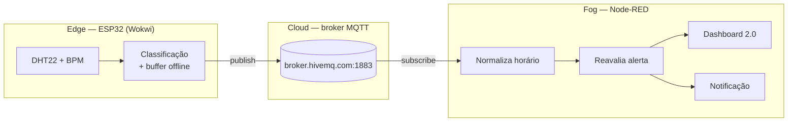
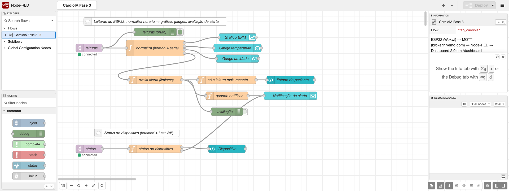

# CardioIA — Fase 3 · Relatório da Parte 2

## Transmissão para a nuvem e visualização (Fog/Cloud Computing)

**FIAP — Inteligência Artificial · Projeto CardioIA**

Equipe: Guilherme Paes Barreto Didier Garcia (RM568457) · Davis Roberto (RM567941) · Guilherme Chan (RM567722) · Deivid Paula da Silva Oliveira (RM566752)

---

### 1. Arquitetura



- **Edge (ESP32):** lê os sensores, classifica cada leitura e segura os dados quando a
  conexão cai (Parte 1).
- **Cloud (broker MQTT):** recebe as publicações do dispositivo e as entrega a quem assina
  os tópicos. Um dispositivo não precisa saber quem consome seus dados.
- **Fog (Node-RED):** fica entre o dado bruto e quem decide. Reconstrói o horário das
  leituras, reaplica as regras de alerta, decide quando avisar a equipe e monta o painel.

### 2. Comunicação MQTT

**Broker.** Usamos `broker.hivemq.com`, na porta 1883, sem autenticação. É o broker público
de testes da HiveMQ, sugerido pelo enunciado. Pesamos a alternativa, o HiveMQ Cloud com TLS
e usuário/senha, e a descartamos para o protótipo: o projeto no Wokwi é público, e qualquer
credencial no código ficaria exposta a quem abrisse o link. A seção 3 discute o que muda em
produção.

**Biblioteca.** `PubSubClient` (MQTT 3.1.1) sobre `WiFiClient`. No Wokwi, o ESP32 se conecta à
rede `Wokwi-GUEST`, que dá acesso de saída à internet.

**Tópicos.** O prefixo é único para não colidir com outros usuários do broker público:

| Tópico | Conteúdo | Retained |
|---|---|---|
| `cardioia/fase3/g568457/paciente/P001/leituras` | toda leitura (tempo real ou buffer) | não |
| `cardioia/fase3/g568457/paciente/P001/alertas` | só as leituras em alerta | não |
| `cardioia/fase3/g568457/paciente/P001/status` | estado do dispositivo, a cada 10 s e a cada mudança | **sim** |

O Node-RED assina `cardioia/fase3/g568457/paciente/+/leituras`. O `+` aceita qualquer
paciente, então o mesmo flow serve para outros dispositivos.

**Payload de leitura** (JSON, ~170 bytes):

```json
{"paciente":"P001","seq":42,"idade_ms":61800,"temp":36.8,"umid":45,"bpm":78,
 "alerta":false,"motivo":"","origem":"buffer","buffer_pendente":12}
```

| Campo | Significado |
|---|---|
| `paciente` | Pseudônimo. Nenhum dado pessoal sai do dispositivo |
| `seq` | Número sequencial da leitura; permite conferir ordem e lacunas |
| `idade_ms` | Há quanto tempo a leitura foi feita. O receptor calcula o horário real |
| `temp`, `umid`, `bpm` | Medidas (`null` se o DHT22 falhar) |
| `alerta`, `motivo` | Classificação feita no ESP32 (`taquicardia`, `febre`, `taquicardia+febre`…) |
| `origem` | `tempo_real` ou `buffer` (enviada depois de uma queda) |
| `buffer_pendente` | Quantas leituras ainda faltam sincronizar depois desta |

**Confiabilidade.** O `PubSubClient` só publica com QoS 0: a mensagem é entregue no máximo uma
vez, sem confirmação do broker. Compensamos isso em três pontos:

1. O buffer só apaga um registro quando o `publish()` retorna sucesso.
2. O `seq` torna as lacunas visíveis do lado de quem recebe.
3. O dispositivo registra uma **Last Will** no tópico de status (`{"online":false,"motivo":"lwt"}`):
   se cair sem avisar, o broker publica o offline em nome dele. Ao desligar o Wi-Fi pelo
   botão, o firmware publica `online:false` antes de desconectar, porque uma desconexão
   limpa não dispara a Last Will.

**Reconexão.** Com o Wi-Fi simulado ligado e o broker desconectado, o firmware tenta de novo
a cada 5 s, sem bloquear o `loop()`. A leitura dos sensores continua normalmente, e o que
for lido nesse meio-tempo vai para o buffer.

### 3. Segurança e LGPD

Dado de saúde é dado pessoal sensível (LGPD, art. 11). O protótipo já adota quatro cuidados:

- **Pseudonimização:** o dispositivo só conhece `P001`. A ligação entre o código e o paciente
  ficaria num sistema separado.
- **Payload mínimo:** só as medidas e o necessário para interpretá-las. Nada de nome,
  documento ou localização.
- **Sem segredos no código:** não há senha no firmware nem no flow.
- **Prefixo de tópico único:** evita misturar os dados com os de outros usuários do broker
  público.

O protótipo **não** é seguro para dados reais: o broker público aceita qualquer assinante
de `cardioia/#`. Para produção, mudaríamos:

| Hoje (protótipo) | Produção |
|---|---|
| Porta 1883, texto aberto | TLS na porta 8883 (`WiFiClientSecure`), com certificado do broker validado |
| Sem autenticação | Credencial única por dispositivo, gravada na fábrica, nunca no código-fonte |
| Qualquer um assina qualquer tópico | ACL: o dispositivo só publica no próprio tópico; só o backend assina |
| Broker público compartilhado | Broker privado (HiveMQ Cloud, EMQX, AWS IoT Core) |
| Sem política de retenção | Retenção e descarte definidos, com registro de acesso |

### 4. Node-RED: fluxo e dashboard

Rodamos o Node-RED 5 localmente com o **Dashboard 2.0** (`@flowfuse/node-red-dashboard`), o
sucessor oficial do `node-red-dashboard` antigo, que está marcado como sem manutenção. O
flow está em `node-red/flows.json`, e as instruções para importar estão no README.



| Nó | Tipo | O que faz |
|---|---|---|
| `leituras` | mqtt in | Assina `.../+/leituras` e converte o JSON |
| `normaliza (horário + série)` | function | Calcula o horário real (`agora − idade_ms`), conta as leituras vindas do buffer e mantém a série de BPM ordenada por horário |
| `Gráfico BPM` | ui-chart | Linha, eixo X em tempo, janela de 15 min |
| `Gauge temperatura` | ui-gauge | Meia-lua de 34 a 42 °C. Faixas: azul < 35, verde 35–37,5, amarelo 37,5–38, vermelho > 38 |
| `Gauge umidade` | ui-gauge | 0–100 %, só contexto |
| `avalia alerta (limiares)` | function | Reaplica os limiares (120/50 bpm, 38/35 °C) e avisa se discordar do ESP32 |
| `só a leitura mais recente` | function | Impede que uma leitura antiga, chegando do buffer, sobrescreva o estado atual |
| `Estado do paciente` | ui-template | Faixa verde "Sinais vitais normais" ou vermelha "ALERTA — taquicardia" |
| `quando notificar` | function | Avisa só quando o estado muda e resume em uma notificação os alertas ocorridos offline |
| `Notificação de alerta` | ui-notification | Aviso vermelho (alerta), verde (normalizou) ou laranja (alertas da queda) |
| `status` → `Dispositivo` | mqtt in → ui-template | Online/offline, ocupação do buffer, leituras sincronizadas e descartes |

**Decisões de configuração:**

- **Série ordenada em vez de "append".** Na sincronização, chegam leituras com horário
  anterior às que já estão no gráfico. Com "append", a linha voltaria no tempo e faria um
  zigue-zague. Por isso o nó `normaliza` mantém a série ordenada, e o gráfico usa o modo
  *replace*. As leituras da queda preenchem o buraco no lugar certo.
- **Alerta avaliado nos dois lados.** O ESP32 precisa classificar para decidir o que
  preservar no buffer. O Node-RED reavalia para que os limiares fiquem visíveis e ajustáveis
  no flow, sem regravar o firmware. Se os dois discordarem, o nó gera um aviso.
- **Notificação sem ruído.** Uma leitura a cada 2 s em taquicardia viraria 30 notificações
  por minuto. A notificação dispara só na transição normal → alerta → normal. Os alertas que
  chegam do buffer viram **um** aviso no fim da sincronização, por exemplo: "Sincronização:
  4 alerta(s) ocorreram durante a queda de conexão (primeiro às 17:09:02 taquicardia+febre)".

### 5. Evidências

As imagens do dashboard abaixo foram geradas com o `tools/simulador_esp32.py`, que publica
no broker **exatamente** o formato do firmware, com roteiro controlado (normal → alerta;
online → queda → sincronização). Escolhemos o simulador para que os prints mostrassem cada
situação de forma reproduzível. O envio pelo ESP32 real no Wokwi aparece na seção 5.4.

**5.1 Alerta em tempo real.** O BPM passa de 120 e a temperatura de 38 °C: a faixa fica
vermelha, o gauge entra na zona vermelha e a notificação aparece.


**5.2 Queda de conexão.** O dispositivo publica `online:false` e o painel "Dispositivo" fica
laranja. O gráfico para de receber pontos.


**5.3 Volta da conexão.** As 20 leituras guardadas chegam em rajada e preenchem o buraco do
gráfico no horário em que foram medidas, incluindo o pico de taquicardia que aconteceu
offline. A notificação laranja resume os 4 alertas da queda.


**5.4 ESP32 no Wokwi publicando no broker.** <!-- PRINT DO WOKWI: Monitor Serial com [MQTT] conectado e [NUVEM] + dashboard recebendo -->

O painel também funciona no celular (grade de 3 colunas abaixo de 576 px):
`img/dashboard_celular.png`.

### 6. Como reproduzir

```bash
# Node-RED + Dashboard 2.0
cd node-red && npm install && npm start      # editor: http://localhost:1880
                                             # painel: http://localhost:1880/dashboard
# Simulador (opcional, sem Wokwi)
python -m venv .venv && .venv/bin/pip install -r requirements.txt
.venv/bin/python tools/simulador_esp32.py --cenario queda
```

No Wokwi, basta abrir o projeto e iniciar a simulação. O ESP32 se conecta sozinho ao broker,
e o dashboard começa a receber os dados.

### 7. Limites

- O broker público não garante disponibilidade nem privacidade. Se ele cair, as constantes
  `MQTT_HOST` (firmware) e `broker` (flow) aceitam `test.mosquitto.org`.
- O estado do dashboard (série, contadores) fica na memória do Node-RED e zera ao
  reiniciá-lo. Persistência fica para as próximas fases.
- QoS 0: uma mensagem perdida entre o broker e o Node-RED não é reenviada. O `seq` mostra a
  lacuna, mas não a recupera.
